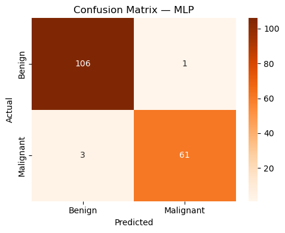
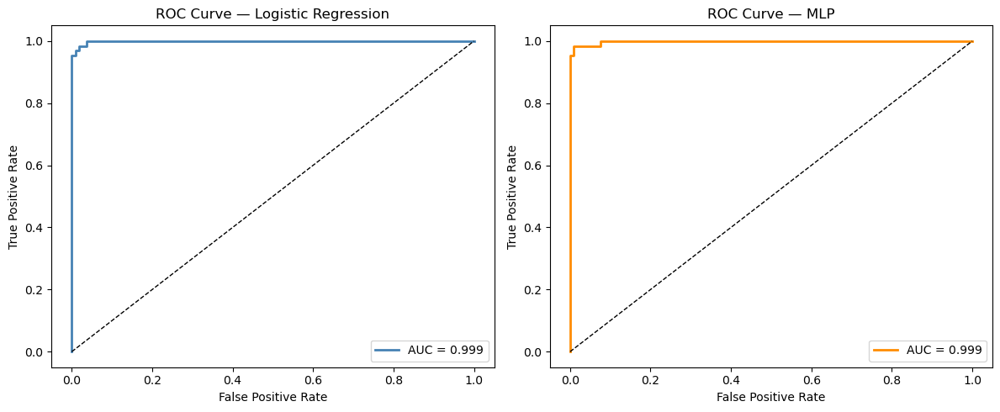

# 🎗️ Breast Cancer Tumour Classification

A machine learning project that classifies breast tumours as **malignant or benign** from 30 cell-nucleus measurements, comparing a **Logistic Regression** baseline with a **Multi-Layer Perceptron (MLP) neural network**.

The emphasis is on evaluating the models properly for a medical setting, where missing a malignant tumour (a false negative) matters far more than overall accuracy.

---

## 📁 Dataset

- **Source:** [Breast Cancer Wisconsin (Diagnostic)](https://archive.ics.uci.edu/dataset/17/breast+cancer+wisconsin+diagnostic), UCI Machine Learning Repository
- **Size:** 569 tumours × 30 numeric features (mean, standard error and worst value of 10 measurements such as radius, texture and concavity)
- **Target:** Malignant (1) or Benign (0); 212 malignant and 357 benign, so slightly imbalanced
- **Missing values:** none

---

## 🔍 Project Workflow

1. **Exploration:** shape, summary statistics, missing-value check, class distribution
2. **Preprocessing:** label-encoded the target, then a **stratified 70/30 train/test split** (preserving the class ratio), with `StandardScaler` fitted on the training data only
3. **Model 1, Logistic Regression:** baseline model, classification report and confusion matrix
4. **Model 2, MLP neural network:** logistic activation, Adam optimiser, L2 regularisation (`alpha=0.1`); training loss curve and train vs test accuracy checked for overfitting
5. **ROC curves and AUC** for both models
6. **10-fold stratified cross-validation** to check the results hold beyond one split
7. **Model comparison:** accuracy, precision, recall and F1 side by side

---

## 📊 Results

| Model | Test accuracy | Precision (malignant) | Recall (malignant) | F1 (malignant) | ROC AUC | 10-fold CV accuracy |
|---|---|---|---|---|---|---|
| Logistic Regression | 97.66% | 0.98 | 0.95 | 0.97 | 0.999 | 98.07% ± 1.46% |
| MLP neural network | 97.66% | 0.98 | 0.95 | 0.97 | 0.999 | 98.07% ± 1.66% |

| MLP confusion matrix (test set, 171 tumours) | ROC curves |
|---|---|
|  |  |

---

## 🧠 Key Findings

- **Both models performed identically** on the test set and in cross-validation. The MLP adds complexity and is harder to explain, but gives no measurable gain, so the simpler **Logistic Regression is the better choice** for this dataset. A well-scaled linear model is already enough to separate the classes.
- **3 of 64 malignant tumours were missed** (false negatives) and 1 benign tumour was flagged as malignant. In a screening context, those 3 misses matter most, so the next step would be to optimise for **malignant recall** rather than overall accuracy, for example by lowering the decision threshold and accepting more false positives.
- **No sign of overfitting:** the MLP's training accuracy (98.74%) is close to its test accuracy (97.66%), and cross-validation results are consistent across folds.

---

## ⚠️ Limitations and Next Steps

- **Cross-validation scaling:** the train/test split is leakage-free, but the cross-validation step reuses data already scaled with training-set statistics. Wrapping the scaler and model in a scikit-learn `Pipeline` would make cross-validation fully leakage-free.
- **Small dataset:** 569 samples from a single source; results may not generalise to other hospitals or imaging equipment.
- **Threshold tuning:** both models use the default 0.5 probability threshold; tuning it for recall is the most clinically relevant improvement.

---

## ▶️ How to Run

1. Download the dataset from the [UCI link above](https://archive.ics.uci.edu/dataset/17/breast+cancer+wisconsin+diagnostic) and save it in this folder as `Breast_cancer.csv`. The notebook expects an ID column first, the 30 features next, and the diagnosis (`M`/`B`) as the last column.
2. Install the dependencies:
   ```bash
   pip install -r requirements.txt
   ```
3. Open and run `Breast_Cancer_Classification.ipynb` in Jupyter.

---

## 🛠️ Technologies Used

Python 3 · Pandas, NumPy · Scikit-learn (Logistic Regression, MLPClassifier, StandardScaler, StratifiedKFold, ROC/AUC) · Matplotlib, Seaborn

---

## 👤 Author

**Arman Arabkhani**
Final-year Computer Science (Data Science) student @ Auckland University of Technology
📧 armanarabkhani.nz@yahoo.com
🔗 [LinkedIn](https://www.linkedin.com/in/arman-arabkhani-95903a384/) | [GitHub](https://github.com/AremonNZ)
